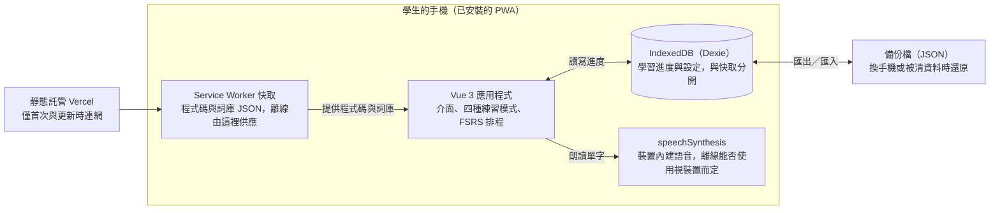

# 高中生背單字 PWA 計畫書

2026-10-23

App 名稱「一字不漏」：以 Vue 3 + Vite 做成可離線安裝的 PWA，內建學測與多益詞庫，用 FSRS 排程複習並專門處理答錯的字，資料全部存在學生自己的裝置，不需要後端。

## 目標與範圍

服務對象是普通高中生：每天花約 10 分鐘，在手機上用間隔複習背完學測與多益單字，沒有網路也能開。

**要做**

- 內建兩套詞庫：學測（大考中心高中英文參考詞彙表 Level 1–6 全部）與多益（TOEIC Service List，約 1,200 字）
- 四種練習：翻卡、選擇題、拼字、聽寫，答錯的字有專屬的答錯複習計畫
- PWA：可加到主畫面，完全離線開啟
- 學習進度存在本機，可匯出／匯入 JSON 備份

**不做**

- 帳號、登入、跨裝置同步
- 後端與資料庫；不蒐集任何學習資料或使用分析（學生多為未成年，隱私最單純）
- 即時 AI 生成內容（API key 不能放前端）；例句改在建置階段預先產生

## 整體架構

App 在手機裡自成一體：連網只發生在第一次載入與版本更新，之後的讀寫、複習與發音都在本機完成。

## 技術選型（推薦）

整套用 Vue 生態加幾個小型函式庫，執行時不依賴任何外部服務。

| 層 | 推薦 | 理由 |
| --- | --- | --- |
| 框架 | Vue 3 + Vite + TypeScript + Pinia | 你已熟悉；打包小、手機載入快 |
| PWA | vite-plugin-pwa（Workbox） | 自動產生 Service Worker 與 manifest，並預先快取詞庫 |
| 本機資料庫 | Dexie.js（IndexedDB） | 容量大、非同步；localStorage 只放簡單設定 |
| 複習排程 | ts-fsrs | 現成的 FSRS 實作，不必自己寫與調參 |
| 發音 | Web Speech API（speechSynthesis） | 免費、免 API key；離線是否可用取決於裝置語音 |
| 詞庫處理（建置時） | Node 腳本 + OpenCC | 一次性把簡體釋義轉繁體，產出靜態 JSON |
| 部署 | 靜態託管：Vercel | 只有靜態檔；Service Worker 要求 HTTPS，Vercel 預設提供 HTTPS |

## 內建詞庫

詞庫在建置時整理成靜態 JSON，隨 App 一起預先快取；現成資料多半是簡體釋義、且沒有多益分級，需要自己組裝，授權要先確認。

| 詞庫 | 單字清單來源 | 中文釋義 | 待確認 |
| --- | --- | --- | --- |
| 學測 | 大考中心高中英文參考詞彙表（111 學年度起適用），Level 1–6 全部，約 6,000 詞條；只有詞性與級別，沒有中文釋義 | ECDICT 英漢詞典（簡體中文，需用 OpenCC 轉繁體並校對台灣用語） | 詞表僅限非營利使用並須註明出處；ECDICT 多數封裝標示 MIT，上游 LICENSE 仍要確認 |
| 多益 | TOEIC Service List 1.2（TSL，約 1,200 字，第三方詞表，非 ETS 官方），附頻率排名；只有英文，沒有中文釋義 | 同上，TSL 的字也用 ECDICT 補中文釋義 | CC BY-SA 4.0：須註明出處，衍生的詞表資料也要用相同條款釋出 |

**查證結果與決定**

- 學測：全用 Level 1–6。詞表條目只有「單字、詞性、級別」，且有 `agree(ment)`、`bicycle/bike` 這類合併寫法，建置時要寫腳本拆開、去重、標準化。
- 多益：沒有 ETS 官方詞表，採用 TSL；它與 NGSL（2,809 字）合計約涵蓋 98.5% 的多益文本。多益與學測重複的字合併成一筆，只保留一份進度。
- 分級：TSL 沒有 600、730、860 這類分數段，建議依頻率排名切成三批（入門、中階、進階），不假裝是官方分級。
- 授權：大考中心詞表在非營利、註明出處的前提下可用，若 App 收費或放廣告需先取得書面授權；TSL 與其衍生資料須標示出處並以 CC BY-SA 4.0 釋出。ECDICT 的授權我只在第三方套件頁面看到（多數標 MIT，一個 Arch 套件標 GPL3），沒讀到上游 LICENSE，開工前請到專案倉庫確認。以上是我讀條款後的整理，不是法律意見，以原文為準。

**資料分兩份，更新詞庫時才不會弄丟進度**

- 單字資料（唯讀，隨版本更新）：id、單字、詞性、中文、例句、例句中文、等級、標籤
- 學習進度（IndexedDB，使用者可變動）：單字 id、下次複習時間、FSRS 狀態、複習次數、答錯次數
- 單字 id 必須跨版本固定不變，否則詞庫更新後進度會對不上

**例句**：在建置階段用 AI 預先產生並人工抽查，成品只是靜態文字，因此不需要在前端放 API key。

**體積**：約 7,000 字加例句，我估計 JSON 在 1–2 MB 上下（粗估），壓縮後更小，手機預先快取沒有問題。

## 學習功能

複習排程推薦 FSRS（用 ts-fsrs）：學生常中斷好幾天，FSRS 對「拖很久才複習」的處理比 SM-2 合理，而且函式庫現成，開發成本不比 SM-2 高。

| 練習模式 | 做法 | 練到的能力 |
| --- | --- | --- |
| 翻卡 | 看英文、想中文，自己評分 | 認字 |
| 選擇題 | 四選一，干擾項取自同詞性、同等級的字 | 辨識 |
| 拼字 | 看中文與詞性，輸入英文 | 拼寫 |
| 聽寫 | 唸出單字，輸入拼法 | 聽力與拼寫 |

**評分方式**

- 翻卡：四顆按鈕（忘了、模糊、記得、太簡單），直接對應 FSRS 的四個等級
- 測驗類：自動評分，答錯算「忘了」，答對算「記得」

**每日節奏**：可設定每天新字數與複習上限（新字預設 20 個），避免複習量堆積；首頁顯示今日待複習數與連續學習天數（每連續 10 天一個里程碑）。

## 答錯複習計畫

答錯的字走一條專屬流程：當天補救、隔天與第 3 天追蹤，再交回 FSRS 的常規排程；反覆答錯的字另外標記加強。

| 時間點 | 做法 |
| --- | --- |
| 答錯當下 | 顯示正確答案與例句；該字重新排入本次練習，隔 3–5 張卡後再考一次，答對才算過關 |
| 本次練習結束 | 「今日錯題」再清一輪，全部答對才結束 |
| 隔天、第 3 天 | 各再考一次（短間隔），之後交回 FSRS 常規排程 |
| 累積答錯 3 次以上 | 標記為「頑固字」：優先出拼字與聽寫題，例句固定顯示 |

**錯題本頁面**：列出所有答錯過的字，依累積答錯次數排序，可一鍵「只練錯題」。

**每日量控制**：錯題複習不占每天 20 個新字的額度；待複習數過多時，首頁提醒並建議先暫停新字，避免積壓。

上面的次數與間隔都是預設值，試用後依學生的實際答對率調整。

## PWA 與離線

離線靠 Service Worker 預先快取，進度不被清掉靠「加到主畫面」加上定期備份，這兩件事要在介面上主動引導學生。

- **預先快取**：第一次連網開啟時，程式碼與詞庫 JSON 一次存好，之後飛航模式也能開。
- **更新**：新版下載完成後，畫面提示「有新版本，重新整理」；詞庫帶版本號。進度放在 IndexedDB，與快取分開，更新不會動到它。
- **儲存不被清掉**：啟動時呼叫 `navigator.storage.persist()` 請求持久儲存。iOS Safari 對未加到主畫面的網站，閒置約 7 天可能清掉本機資料，所以首次使用要引導「加到主畫面」；Android 用 `beforeinstallprompt` 做安裝按鈕，iOS 則做圖文教學。
- **備份**：設定頁提供匯出／匯入 JSON，並每週提醒一次；這是換手機或被清資料時唯一的救生繩。
- **發音離線**：`speechSynthesis` 能否離線取決於裝置有沒有下載語音；偵測不到語音時，聽寫模式顯示提示或隱藏。
- **驗收**：在 iPhone Safari 與 Android Chrome 實機，開飛航模式完整跑一輪複習。

## 開發階段

分四階段，每階段結束都有一個能拿給學生試的版本；工期是以單人兼職開發粗估，僅供排程參考。

1. **可用骨架（約 1–2 週）**：Vue + Vite 專案、PWA 離線、Dexie 資料層、FSRS 排程、翻卡複習，先放約 200 字的測試詞庫。驗收：飛航模式能完成一輪複習，重開後進度仍在。
2. **詞庫與練習模式（約 2–3 週）**：建置腳本整理學測與多益詞庫（簡轉繁、產生例句、人工抽查）；加入選擇題、拼字、聽寫與發音，並做出答錯複習計畫（當日重考、錯題本）。驗收：兩套詞庫完整載入，四種模式可用，答錯的字依計畫重新出現。
3. **補強（約 1 週）**：匯出／匯入備份、持久儲存請求、安裝引導（Android 與 iOS）、更新提示、每日上限、連續天數里程碑與簡單統計。驗收：備份後清空資料，能完整還原。
4. **試用與發布（約 1–2 週）**：找幾位學生用 iPhone 與 Android 實機試用，修 bug、調文案，正式上線並產出 QR code。驗收：學生不用教學就能安裝並開始背。

## 風險與待確認事項

最大的風險是詞庫授權與學生進度被瀏覽器清掉，前者已初步查證，App 不收費、不放廣告，大考中心詞表可在註明出處下使用。

| 風險 | 影響 | 對策 |
| --- | --- | --- |
| 詞庫授權不明 | 無法安心公開發布 | 大考中心詞表僅限非營利使用；要收費或放廣告就先取得書面授權，否則改用自編詞表 |
| 多益沒有官方詞表（TSL 為第三方詞表） | 要遵守 CC BY-SA 的標示與相同條款釋出義務 | 採用 TSL 1.2，標示出處並以相同條款釋出衍生詞表 |
| 進度被清掉（iOS 閒置規則、清快取） | 學生失去學習紀錄 | 引導加到主畫面、請求持久儲存、每週備份提醒 |
| 簡轉繁後用語不像台灣 | 學生看到不自然的釋義 | OpenCC 使用台灣用語模式（s2twp），再人工抽查 |
| AI 例句有錯 | 誤導學生 | 建置時抽查，保留修正紀錄 |
| 離線沒有語音 | 聽寫模式無法使用 | 偵測語音，沒有就隱藏或提示 |

**已決定**

- 學測詞表用 Level 1–6 全部
- 多益詞庫採用 TSL（約 1,200 字），依頻率排名切成三批（入門、中階、進階）
- 每天新字預設 20 個
- 部署在 Vercel
- 要有答錯複習計畫
- 連續天數：每連續學習 10 天一個里程碑
- App 名稱：一字不漏
- App 不收費、不放廣告，因此大考中心詞表只需註明出處，不必書面授權

**仍待確認**

- [ ] 開工前到 ECDICT 專案倉庫確認上游 LICENSE

## 資料來源

- [TOEIC Service List（New General Service List Project）](https://www.newgeneralservicelist.com/toeic-service-list)
- [高中英文參考詞彙表（111 學年度起適用，大考中心，PDF）](https://nehs.ptc.edu.tw/uploads/1720493970347Ow0GEJpz.pdf)

ECDICT 的授權只見於第三方套件頁面，未讀到上游專案的 LICENSE。查證日：2026-10-23。
